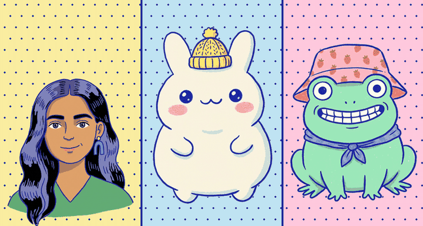

# Rigpop Talk 🐸🎙️

**Make doodles talk.** Drop in a voice note and a doodle character lip-syncs it, blinks, and bobs along. Export a 9:16 reel with sound, all in your browser. No server, no sign-up, no API key.

## How it works

1. **Pick a character:** Swapnil (the maker, drawn in blue-ink comic style), Mochi the bunny-cat, or Froggo.
2. **Add a voice:** upload audio (mp3, wav, m4a, or even a video file), record from your mic, or go **Live mic** and watch the character copy you in real time.
3. **Style it:** background colour or your own image, dots or stars pattern, an optional title sticker, 9:16 / 1:1 / 16:9.
4. **Export:** you get a proper MP4 with the audio baked in, rendered faster than real time, with the correct length in any gallery app.

## Bring your own doodle 🖍️

Tap **＋ Your doodle** and upload any character drawing. Rigpop Talk removes a plain background, then you drag a box over the mouth and tap the two eyes. It paints talking mouth shapes in the doodle's own skin and ink colours, and adds blinks. Your last four doodles are remembered in this browser.

## Background music 🎵

Add any song or beat under the voice. It loops, fades in and out, and dips automatically while a character talks. Set the volume, or switch the ducking off.

## Auto captions ✍️

Tap **Make captions** and Whisper (running in your browser through transformers.js) turns the voice into bouncy, word-highlighted subtitles. Pick Auto, Hindi, English, or Hinglish (Hindi written in Roman letters). Every line is editable before export. The first run downloads a ~75 MB model, which the browser then caches. No audio leaves your device.

## Hand gestures 🙌

**Dr. Swapnil** comes with four hand poses: wave, point up, open palms, and thumbs up. While she talks, she waves hello at the start and gestures every few seconds. When captions are on, words trigger matching gestures ("hello" waves, "idea" points, "great"/"badhiya" gives a thumbs up, "why"/"kyun" opens the palms). Switch it off in Style.

**Any uploaded doodle can gesture too:**
- **Bendy arms**: in the doodle setup, tap the left and right shoulder. The app draws rubber-hose cartoon arms in your doodle's skin, sleeve, and ink colours.
- **Pose pictures**: open "Add pose pictures," copy the AI prompt, make wave, point, open-palm, and thumbs-up versions of your picture in ChatGPT or Gemini, and upload them. The app swaps them in while your doodle talks.

## Duet mode 👯

Make two characters talk to each other. Tap **Duet**, pick who stands on the left and right, then add the conversation line by line: choose who says it, and record or upload that line. You can voice both sides yourself. The speaker lip-syncs and leans in a little while the other one listens and blinks. Lines can be reordered, deleted, or switched to the other character. Export works the same way.

## Under the hood

- **Lip sync:** the Web Audio API reads loudness and three frequency bands every frame and picks a mouth shape: rest, **A** (open), **O** (round), **E** (wide/teeth). Shapes are held for at least 70 ms so the mouth doesn't flicker.
- **Life:** random blinks every 2 to 5.5 s, breathing, and a head bob that follows how loud you are.
- **Characters:** each one is a transparent base picture plus small mouth and blink patches that sit exactly over the face (`characters/characters.json` holds the positions).
- **Export:** every frame is drawn offline and encoded with WebCodecs (H.264 + AAC), then packed into an MP4 with [mp4-muxer](https://github.com/Vanilagy/mp4-muxer) (vendored in `lib/`). Browsers without WebCodecs fall back to `MediaRecorder`.

## Run it

It's a single `index.html`. Serve the folder with any static server (`npx serve .`) or deploy it on GitHub Pages or Vercel. Opening the file directly works for preview, but export needs it served over http(s).

## Add your own character

Put `name_base.png` (transparent) plus `name_A.png`, `name_O.png`, `name_E.png` and `name_blink.png` patches in `characters/`, then add the patch positions to `characters/characters.json` and the `CHARS` list in `index.html`. An in-app uploader is coming in v0.2.

## Roadmap

- **v0.2:** bring your own character in the app, word-by-word captions (Hindi + English), scene presets (podcast, news anchor, classroom), type a script and it speaks (your own TTS key)
- **v0.3:** two characters in a conversation

Sibling of [Rigpop](https://github.com/swapagrawal14/rigpop) and [WowKit](https://github.com/swapagrawal14/wowkit). Made with 🌷 by [Swapnil Agrawal](https://github.com/swapagrawal14). MIT licensed.
