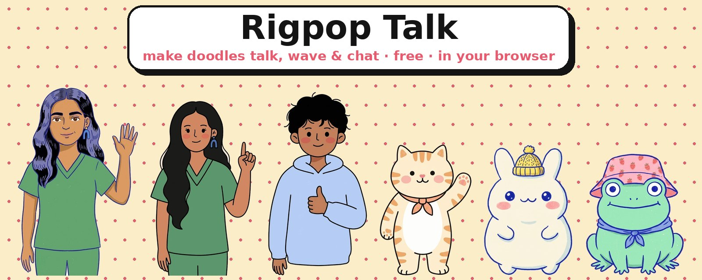
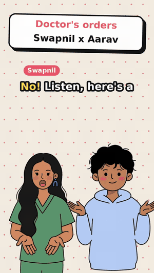
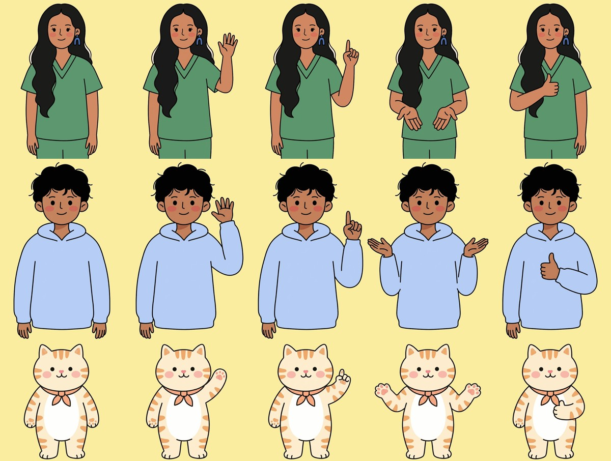
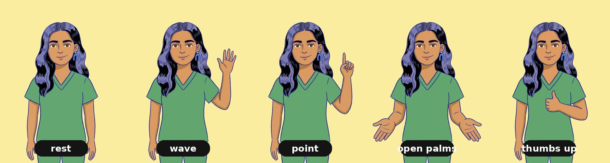
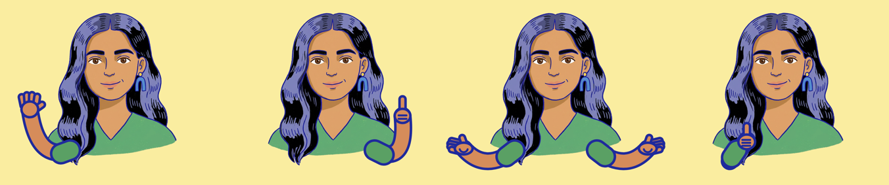

<b>Make doodles talk.</b> Drop in a voice note and a doodle lip-syncs it, blinks, waves, and chats with a friend. 
Export a 9:16 reel with captions and music, all in your browser. No server, no sign-up, no API key.  
<a href="https://rigpop-talk.vercel.app/"><b>▶ Try it live: rigpop-talk.vercel.app</b></a>

---

## 🎬 See it in action

<table>
<tr>
<td align="center" width="50%"> <b>Duet: "Doctor's orders"</b> Doodle Swapnil × Aarav <a href="docs/duet-reel.mp4">Watch the full reel with sound</a></td>
<td align="center" width="50%"> <b>Solo talking head</b> Lip-sync, blinks, and head bob from any voice note</td>
</tr>
</table>

## ✨ What it does

| | |
|---|---|
| 🎙️ **Any voice** | Upload audio or video, record from your mic, or go **Live mic** and watch the character copy you in real time |
| 👄 **Lip-sync** | Mouth shapes (A, O, E, rest), blinks, breathing, and a head bob that follows how loud you are |
| 🙌 **Hand gestures** | Wave, point, open palms, and thumbs up, timed to the speech and triggered by words like "hello", "idea", "badhiya", or "kyun" |
| 👯 **Duet mode** | Two characters talking to each other, line by line |
| ✍️ **Auto captions** | Whisper runs in your browser: Hindi, English, or Hinglish, with word highlighting you can edit |
| 🎵 **Background music** | Loops, fades, and dips automatically under the voice |
| 🖍️ **Your own doodle** | Upload any drawing, mark the mouth and eyes, and it talks in its own colours |
| ⬇️ **Real MP4 export** | H.264 + AAC with the correct length in any gallery app, rendered faster than real time |

## 🌷 Meet the cast

| Character | Style | Gestures |
|---|---|---|
| **Dr. Swapnil** | Blue-ink risograph comic, in scrubs | ✅ |
| **Doodle Swapnil** | Soft Korean doodle, in scrubs | ✅ |
| **Aarav** | Soft Korean doodle, in a hoodie | ✅ |
| **Biscuit** | Soft Korean doodle, a tabby cat | ✅ |
| **Swapnil**, **Mochi**, **Froggo** | The original blue-ink trio | talk + blink |

## 🙌 Hand gestures

While a character talks, it waves hello at the start and gestures every few seconds. With captions on, words trigger the matching move:

- 👋 **Wave:** hello, hi, namaste, bye
- ☝️ **Point:** idea, tip, first, important, listen
- 👍 **Thumbs up:** great, best, yes, badhiya, accha
- 🤲 **Open palms:** why, what, how, so, kyun, kya

Switch it off any time in Style.

## 🖍️ Bring your own doodle, with gestures

1. Tap **＋ Your doodle** and pick a drawing. A plain background is removed automatically. Untick it if it eats part of your art.
2. **Tap the mouth** (or drag a box over it), then tap both eyes so it can blink.
3. **Tap both shoulders** for bendy cartoon arms in your doodle's own skin, sleeve, and ink colours:

4. Want hand-drawn gestures instead? Open **Add pose pictures**, tap **Copy AI prompt**, paste it into ChatGPT or Gemini with your picture, and upload the four poses.
5. **Mouth too big or off-centre?** Use the Mouth size, up/down, and left/right sliders in Style. Your last four doodles are remembered on your device.

## 👯 Duet mode

Tap **Duet**, pick who stands left and right, then add the conversation line by line: choose who says it, and record or upload it. You can voice both sides yourself. The speaker lip-syncs, gestures, and leans in while the other one listens and blinks. Lines can be reordered, switched, or deleted.

## 🛠️ Under the hood

- **Lip-sync:** the Web Audio API reads loudness and three frequency bands every frame and picks a mouth shape. Each shape is held for at least 70 ms so the mouth doesn't flicker.
- **Characters:** a transparent base picture, small mouth and blink patches placed over the face, and optional full pose pictures (`characters/characters.json` holds the positions).
- **Captions:** [transformers.js](https://github.com/huggingface/transformers.js) runs Whisper on your device. The first run downloads a ~75 MB model, which the browser then caches. No audio leaves your device.
- **Export:** every frame is drawn offline and encoded with WebCodecs, then packed into an MP4 with [mp4-muxer](https://github.com/Vanilagy/mp4-muxer) (vendored in `lib/`). Browsers without WebCodecs fall back to `MediaRecorder`.

## 🚀 Run it

It's a single `index.html`. Serve the folder with any static server (`npx serve .`) or deploy it on GitHub Pages or Vercel. Export needs it served over http(s).

## ➕ Add a built-in character

Put `name_base.png` (transparent) plus `name_A.png`, `name_O.png`, `name_E.png`, and `name_blink.png` patches in `characters/`. Optionally add `name_pose_wave.png`, `_point`, `_open`, and `_thumbs` full-size poses. Then add the entry to `characters/characters.json` and the `CHARS` list in `index.html` (with `"poses": [...]` for gestures).

## 🗺️ Roadmap

- Type a script and it speaks (bring your own TTS key)
- Scene presets: podcast, news anchor, classroom
- More expressions: happy, surprised, thinking

---

Sibling of <a href="https://github.com/swapagrawal14/rigpop">Rigpop</a> and <a href="https://github.com/swapagrawal14/wowkit">WowKit</a>. Made with 🌷 by <a href="https://github.com/swapagrawal14">Swapnil Agrawal</a>. MIT licensed.

